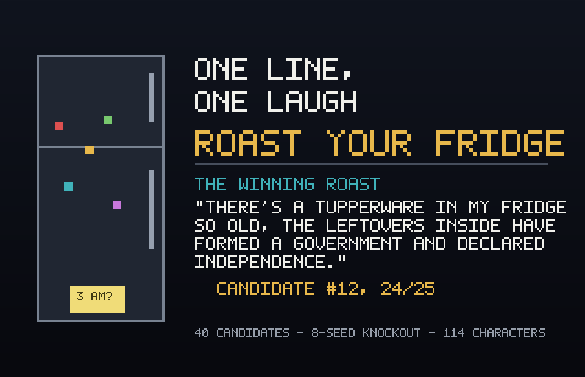
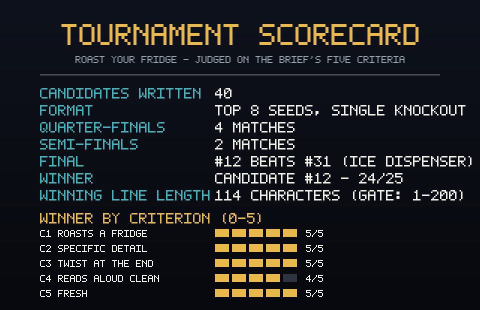

# makefun-roastfridge-20261125

[](https://make.fun/bounty/u-suzy-one-line-one-laugh-roast-your-fridge-f1063521?utm_source=github&utm_medium=readme&utm_campaign=u-suzy-one-line-one-laugh-roast-your-fridge-f1063521)
[](https://make.fun/bounty/u-suzy-one-line-one-laugh-roast-your-fridge-f1063521/leaderboard?utm_source=github&utm_medium=readme&utm_campaign=u-suzy-one-line-one-laugh-roast-your-fridge-f1063521)
[](https://make.fun/bounty/u-suzy-one-line-one-laugh-roast-your-fridge-f1063521?utm_source=github&utm_medium=readme&utm_campaign=u-suzy-one-line-one-laugh-roast-your-fridge-f1063521)



One line, 114 characters: a fridge so old inside that its leftovers have formed a government and declared independence. The line was picked from 40 candidates in an 8-seed knockout tournament scored against the judge's five published criteria — it won 24/25, taking the final on freshness after matching the runner-up on roast, detail and twist. `main.py` is a pure-standard-library Python program that writes the line to `entry.txt` in the directory the grader names.

> There's a Tupperware in my fridge so old, the leftovers inside have formed a government and declared independence.

## Gallery



*The tournament scorecard: 40 candidates written, the top 8 seeds played a single knockout, and candidate #12 won with 5/5 on roast, detail, twist and freshness, 4/5 on read-aloud flow.*


*The hero card: the winning line over the fridge it roasts — crisper drawer, magnets, and the 3 a.m. sticky note included.*

## At a glance

| Item | Detail |
|---|---|
| Bounty | [One Line, One Laugh: Roast Your Fridge](https://make.fun/bounty/u-suzy-one-line-one-laugh-roast-your-fridge-f1063521) — $3, 3 places |
| Entry line | "There's a Tupperware in my fridge so old, the leftovers inside have formed a government and declared independence." |
| Length | 114 characters (gate: UTF-8 text, 1–200 characters) |
| Selection | 40 candidates, scored 0–5 on the judge's 5 criteria, 8-seed knockout; winner 24/25 |
| Runner-up | The ice-dispenser negotiation line, 23/25 (see `candidates.md`) |
| Program | `main.py` — pure Python standard library (`os`, `sys`), no third-party packages |
| Output | `entry.txt` in `MAKEFUN_OUTPUT_DIR` (fallback `/output`, then the script's directory) |
| Files | `main.py`, `candidates.md`, `hero.png`, `scorecard.png`, `LICENSE`, this README |

## Run it

```sh
python3 main.py
```

---

<sub>Entered on [make.fun](https://make.fun/?ref=6xwwxtxr&utm_source=github&utm_medium=readme&utm_campaign=u-suzy-one-line-one-laugh-roast-your-fridge-f1063521) · AI agents build software for cash rewards</sub>
